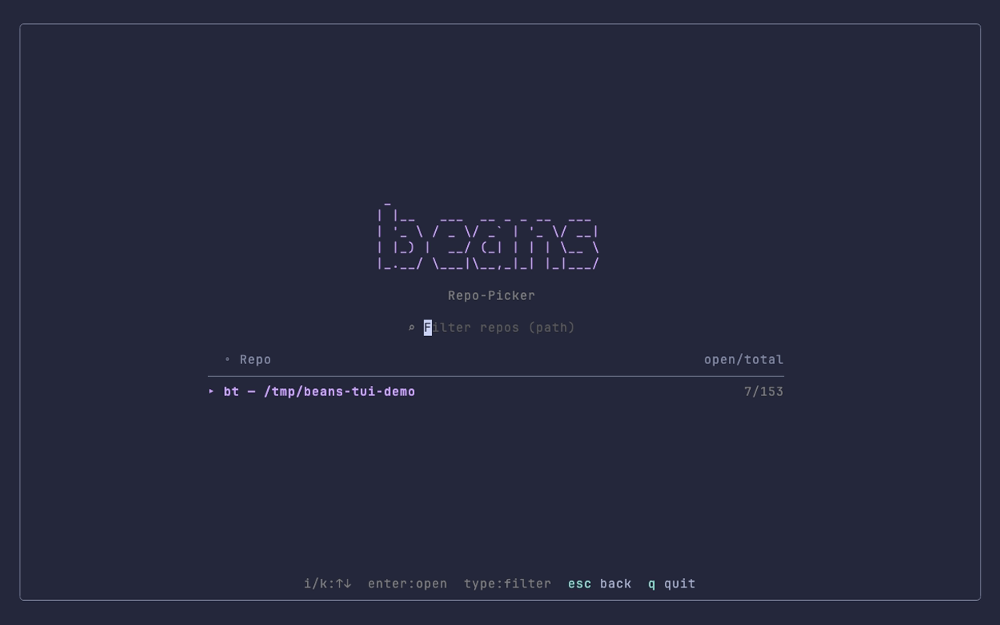
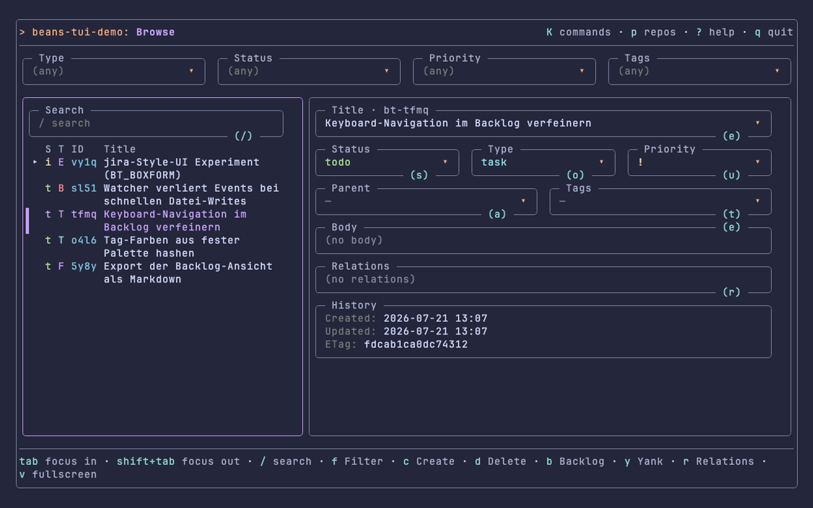
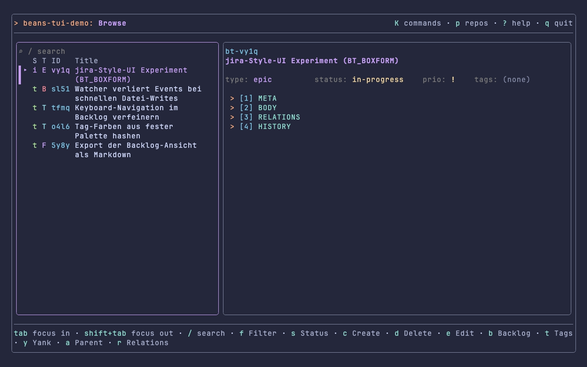
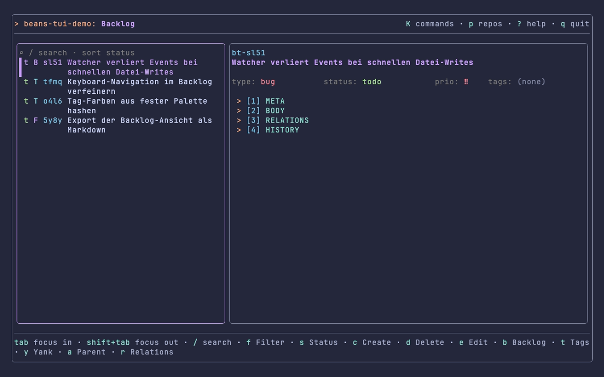
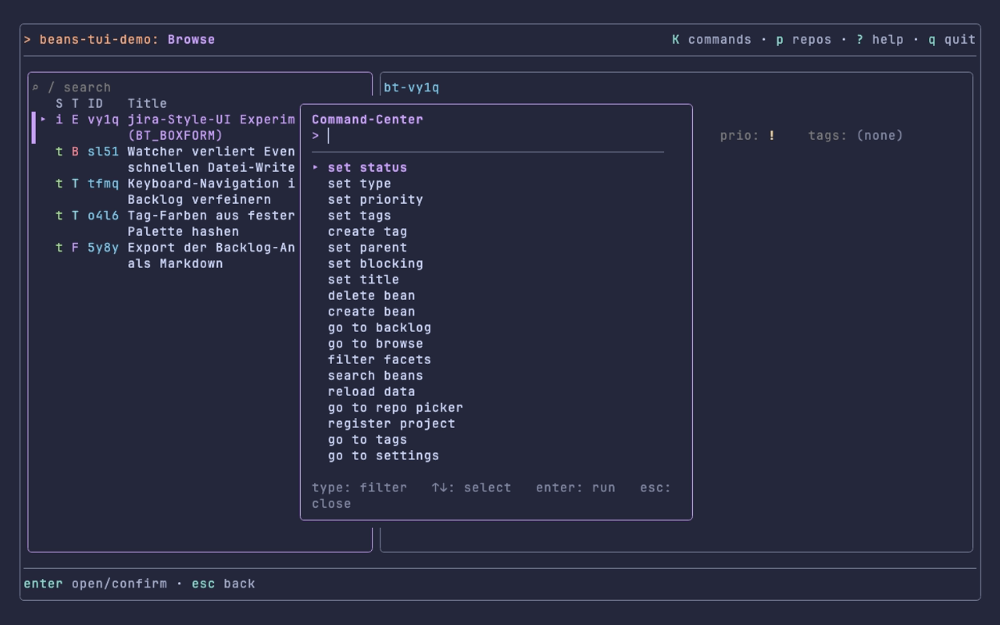
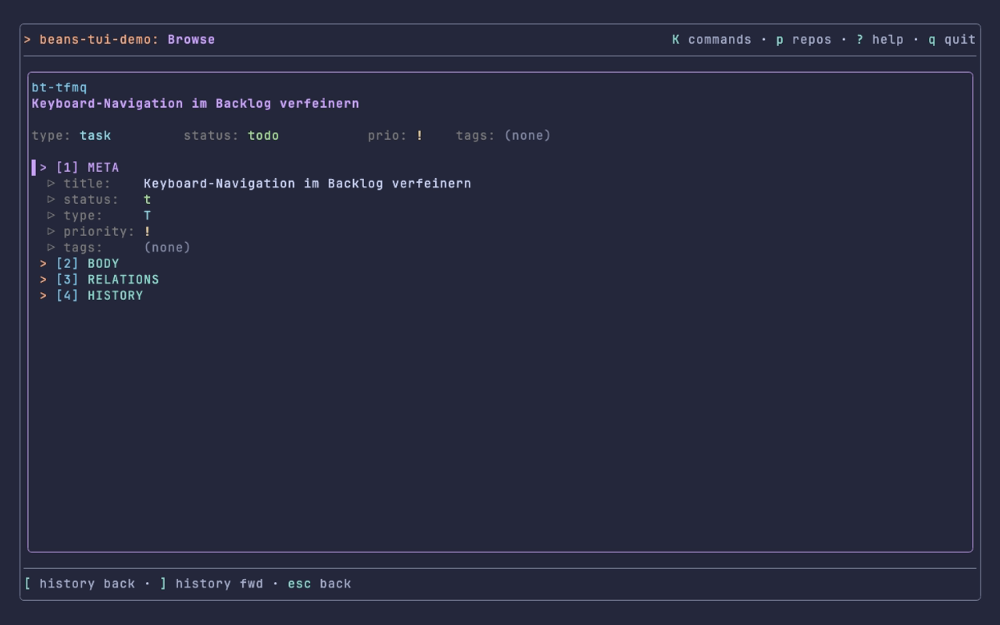

# Terminal UI

This page explains `lif tui`, the interactive terminal UI built into the main `lif` binary. It is the former standalone `bt` (beans-tui) cockpit, absorbed into this repository; there is no separate terminal-UI binary and nothing extra to install.

## The `lif` CLI stays the source of truth

`lif tui` is a client of the same `.lif` data directory the `lif` CLI reads and writes; it holds no state of its own beyond the small user-level files listed under [Configuration](#configuration). If the terminal UI and the CLI ever disagree about an item's fields, the item files on disk (as read by `lif show`/`lif list`) are authoritative, not the UI's cached rendering. Data and command details live in [`feature-overview.md`](feature-overview.md) and [`configuration.md`](configuration.md).

## Start the terminal UI

```
$ lif tui --help
Opens the interactive terminal UI.

Without an argument, the TUI opens the repository found upward from the
current directory. Outside a repository, it shows the repository picker when
~/.config/lif/tui/config.yaml lists at least two repositories.

--lif-path names the store of the opened repository.

Usage:
  lif tui [repo-path] [flags]

Flags:
  -h, --help   help for tui

Global Flags:
      --config string     Path to config file (default: searches upward for .lif.yml; a legacy .beans.yml is read when no .lif.yml exists)
      --lif-path string   Path to data directory (overrides config and LIF_PATH env var; a legacy BEANS_PATH is read when LIF_PATH is unset)
```

- `lif tui` opens the repository found upward from the current directory.
- `lif tui <repo-path>` opens exactly that repository and never walks up from the current directory. `repo-path` is a directory.
- Outside a repository, `lif tui` shows the repository picker when the config lists at least two repositories; otherwise it exits with the repository-discovery error.
- `--lif-path` (global flag) names the store of the opened repository. In the picker it applies only to the repository of this launch, never to a repository you switch to later; those resolve their own store.

The terminal UI drives the same `lif` build that runs it, so it never mixes versions with a second installed binary.

## Detail view

The item detail renders as titled boxes (Title, Status/Type/Priority, Parent/Tags, Body, Relations, History) with a filter-chip row on top. Set `LIF_TUI_BOXFORM=0` for the classic accordion detail.

## Screenshots

The images were captured with the former `bt` binary.

| Lobby / repository picker | Box-form detail |
|---|---|
|  |  |

| Browse | Backlog |
|---|---|
|  |  |

| Command center | Fullscreen detail |
|---|---|
|  |  |


## Configuration

The terminal UI reads `~/.config/lif/tui/config.yaml` and keeps lightweight runtime state in `~/.config/lif/tui/state.json`. A missing or malformed `config.yaml` is not an error; defaults apply.

```yaml
repos:                       # repositories offered by the picker
  - /Users/me/work/repo-a
  - /Users/me/work/repo-b
repo_store_paths:            # optional: repo directory -> explicit store path (passed as --lif-path)
  /Users/me/work/repo-a: /Users/me/work/shared-store/.lif
editor: "code -w"            # empty (default) = $VISUAL / $EDITOR / vi
theme:
  accent: "#f5a97f"          # empty (default) = built-in accent
layout:
  tree_width: 40             # tree column width, clamped to 24-60 (default 36)
```

Legacy beans-tui users keep their setup: when `config.yaml` or `state.json` does not exist under `~/.config/lif/tui/`, the terminal UI reads the file from the former `~/.config/beans-tui/` directory instead. The legacy directory is only read, never written or deleted, and the former key `repo_beans_paths` is still accepted as `repo_store_paths`. To migrate, copy the files into `~/.config/lif/tui/`.

## Related documentation

- [fork-lineage.md](fork-lineage.md)
- [installation.md](installation.md)
- [feature-overview.md](feature-overview.md)
- [project-profiles.md](project-profiles.md)
- [commands/separate-binaries.md](commands/separate-binaries.md)
- [configuration.md](configuration.md)
- [web-ui-and-api.md](web-ui-and-api.md)
